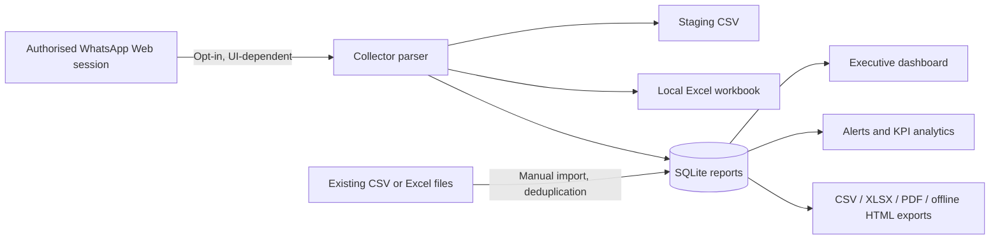

# Architecture

**Components**

- `core.py`: standard-library SQLite persistence, audit trail, metric parsing,
  imports, summary and forecast functions, reports, synthetic seed data.
- `collector.py`: opt-in WhatsApp Web/Playwright workflow, CSV/Excel persistence,
  ingestion bridge and collector diagnostics.
- `desktop.py`: CustomTkinter dashboard, group filters, alert review, monitoring
  controls and exports.
- `app.py`: GUI launcher.
- `manage.py`: headless local database bootstrap, import and demo generation.
- `notebooks/Operational_Intelligence_Demo.ipynb`: read-only, reproducible
  exploration of the supplied schema and synthetic database.

**Database integrity**

`reports.fingerprint` is a UNIQUE SHA-256 hash of normalized group/sender/time/message,
so importing the same message from CSV and Excel will not duplicate it. SQLite uses
write-ahead logging and a busy timeout. `audit` tracks imports and changes.
`alerts`, `monitor_state`, and runtime-created `collection_diagnostics` are separate.

**Date contract**

Incoming WhatsApp metadata is **MDY** for the configured interface (`11/10/2026` =
10 November 2026); the supplied CSV/Excel templates are **DMY** (`10/11/2026`);
SQLite stores ISO (`2026-11-10T...`). These conversions must not be guessed.

**Boundary / limitation**

The two provided sheets have no populated rows and have no fields for manual
pre-3pm changes, post-3pm changes, no-shows or shortages. The current database
therefore models the 11 provided message-report fields; it does **not** claim
to integrate those additional manual tracking categories. They would require
separate source schemas, operational definitions and data validation.
